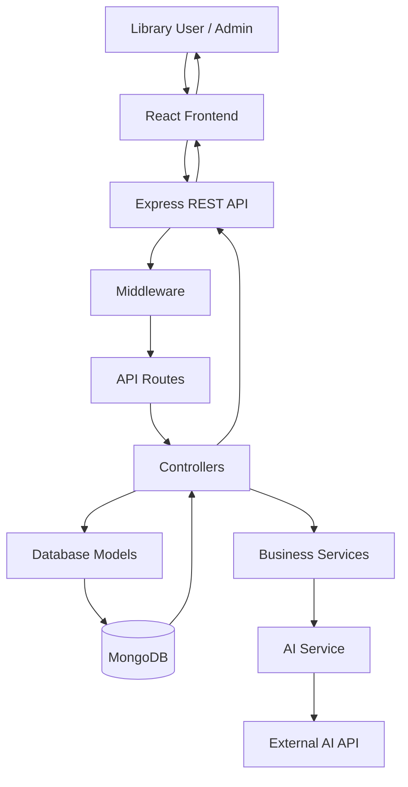

# AI-Enabled Library Management System

## Project Modules and System Architecture

### 1. Project Overview

The AI-Enabled Library Management System is a web-based application designed to manage library operations and provide intelligent book discovery features.

### 2. Major Project Modules

| Module | Responsibility |
|---|---|
| Authentication | Manage user login, registration and access |
| Book Management | Add, update, view and manage book records |
| Member Management | Maintain library member information |
| Issue and Return | Manage book borrowing and returning |
| Search and Discovery | Help users find books by title, author or category |
| AI Services | Support intelligent book recommendations or AI-assisted discovery |
| Dashboard and Reports | Display library statistics and activity summaries |

Note: These are proposed modules and should be aligned with the final approved project blueprint.

### 3. Frontend Responsibilities

- Components: Reusable UI elements
- Pages: Application screens
- Assets: Images and static resources
- Services: API communication
- Styles: CSS and visual styling

### 4. Backend Responsibilities

- Config: Database and application configuration
- Controllers: Handle application requests
- Models: Define database structures
- Routes: Define API endpoints
- Middleware: Handle authentication and request processing
- Services: Business logic and AI integration
- Utils: Reusable helper functions

### 5. System Architecture Diagram

### 6. Basic Workflow

1. User opens the React application.
2. User interacts with a frontend page.
3. Frontend sends a request to the backend API.
4. Express routes direct the request to the appropriate controller.
5. Controllers process the request using services and database models.
6. MongoDB stores or retrieves the required information.
7. AI services process supported intelligent discovery requests.
8. Backend sends a response to the frontend.

### 7. Development Sequence

1. Project setup and configuration
2. Database connection and models
3. Authentication and user management
4. Book catalog management
5. Issue and return functionality
6. Search and discovery
7. AI integration
8. Dashboard, reports and testing

### 8. Conclusion

A modular architecture keeps the application organized, maintainable and easier to expand in future development.
